<b>English</b> &nbsp;·&nbsp; <a href="https://github.com/raul1805/raul1805/blob/main/README.ro.md">Română</a>

<picture>
  <source media="(prefers-color-scheme: dark)" srcset="assets/banner-dark.svg">
  <source media="(prefers-color-scheme: light)" srcset="assets/banner-light.svg">
  
</picture>

  I design and build <b>websites, apps and games</b>, from the first idea to launch and long-term support. 
  I also build, upgrade and set up <b>PCs</b>, so the hardware and software are ready for the work.

  
  
  

## What I do

**Software**
- **Web development & design**: websites and web apps
- **App development & design**: mobile, desktop (PC) and web apps
- **Game development & design**: PC and mobile games built with Unity
- **Development consulting**: analysis, specifications and solutions, from idea to launch

**Hosting & care**
- **Web & app hosting**: managed cloud hosting (e.g. AWS)
- **Maintenance & support**: updates, security, backups

**PC & IT**
- **Operating systems**: install or reinstall (Windows on PC, macOS on Mac) and upgrades (e.g. Windows 10 → 11, newer macOS on compatible Macs)
- **Software setup**: installing and updating software
- **PC builds & upgrades**: custom builds, assembly, upgrades and hardware advice

Coming later: custom 3D printing.

## Tech I work with

<b>Web</b> 
  <picture>
    <source media="(prefers-color-scheme: light)" srcset="https://skillicons.dev/icons?i=html%2Ccss%2Cjs%2Cts%2Creact%2Cnextjs%2Cnodejs%2Cexpress%2Ctailwind%2Cvite&theme=light">
    
  </picture>

<b>Apps & games</b> 
  <picture>
    <source media="(prefers-color-scheme: light)" srcset="https://skillicons.dev/icons?i=cs%2Cdotnet%2Cunity%2Cflutter%2Cdart%2Ckotlin%2Candroidstudio%2Ccpp%2Cpython%2Cblender&theme=light">
    
  </picture>

<b>Cloud & data</b> 
  <picture>
    <source media="(prefers-color-scheme: light)" srcset="https://skillicons.dev/icons?i=aws%2Cfirebase%2Csupabase%2Ccloudflare%2Cvercel%2Cdocker%2Cmysql%2Cpostgres%2Cmongodb%2Csqlite&theme=light">
    
  </picture>

<b>Tools & systems</b> 
  <picture>
    <source media="(prefers-color-scheme: light)" srcset="https://skillicons.dev/icons?i=git%2Cgithub%2Cgithubactions%2Cvscode%2Cvisualstudio%2Cfigma%2Cphotoshop%2Cwindows%2Capple%2Clinux&theme=light">
    
  </picture>

## GitHub activity

  <picture>
    <source media="(prefers-color-scheme: light)" srcset="https://github-readme-stats.vercel.app/api?username=raul1805&show_icons=true&hide=contribs%2Cissues&include_all_commits=true&card_width=495&border_radius=12&bg_color=fbf6ef&title_color=8b1a1a&text_color=2a1a12&icon_color=6b3f26&border_color=c9a27a&ring_color=8b1a1a&cache_seconds=86400">
    
  </picture>
  <picture>
    <source media="(prefers-color-scheme: light)" srcset="https://streak-stats.demolab.com/?user=raul1805&border_radius=12&background=FBF6EF&border=C9A27A&stroke=C9A27A&ring=8B1A1A&fire=8B1A1A&currStreakNum=1D130D&sideNums=1D130D&currStreakLabel=6B3F26&sideLabels=6B3F26&dates=8A6A50">
    
  </picture>

## Projects you can try

**Blooming Flowers**: an animated garden of glowing flowers, built with pure HTML, CSS and JavaScript. 

More live demos are on the way.

> **Want your own version?** [Contact me](https://github.com/raul1805/raul1805/issues/new?template=project-request.yml) and tell me what you need.

## Games and personal projects

**DuoQ**: a social app that helps gamers find people nearby with the same interests, so they never have to play alone. 
In development. Store link coming soon.

## Contact

  
  

Based in Romania · Working in English and Romanian
