<a href="https://github.com/raul1805">English</a> &nbsp;·&nbsp; <b>Română</b>

<picture>
  <source media="(prefers-color-scheme: dark)" srcset="assets/banner-dark-ro.svg">
  <source media="(prefers-color-scheme: light)" srcset="assets/banner-light-ro.svg">
  
</picture>

  Proiectez și dezvolt <b>site-uri, aplicații și jocuri</b>, de la prima idee până la lansare și suport pe termen lung. 
  Asamblez, fac upgrade și configurez <b>PC-uri</b>, ca hardware-ul și software-ul să fie pregătite pentru treabă.

  
  
  

## Ce fac

**Software**
- **Dezvoltare și design web**: site-uri și aplicații web
- **Dezvoltare și design de aplicații**: aplicații mobile, desktop (PC) și web
- **Dezvoltare și design de jocuri**: jocuri pentru PC și mobil, făcute în Unity
- **Consultanță în dezvoltare**: analiză, specificații și soluții, de la idee la lansare

**Găzduire și mentenanță**
- **Găzduire web și aplicații**: găzduire administrată în cloud (de ex. AWS)
- **Mentenanță și suport**: actualizări, securitate, backup

**PC și IT**
- **Sisteme de operare**: instalare sau reinstalare (Windows pe PC, macOS pe Mac) și upgrade (de ex. Windows 10 → 11, macOS mai nou pe Mac-uri compatibile)
- **Instalare software**: instalare și actualizare de programe
- **Configurații și upgrade PC**: PC-uri personalizate, asamblare, upgrade și consultanță hardware

În curând: printare 3D personalizată.

## Tehnologii cu care lucrez

<b>Web</b> 
  <picture>
    <source media="(prefers-color-scheme: light)" srcset="https://skillicons.dev/icons?i=html%2Ccss%2Cjs%2Cts%2Creact%2Cnextjs%2Cnodejs%2Cexpress%2Ctailwind%2Cvite&theme=light">
    
  </picture>

<b>Aplicații și jocuri</b> 
  <picture>
    <source media="(prefers-color-scheme: light)" srcset="https://skillicons.dev/icons?i=cs%2Cdotnet%2Cunity%2Cflutter%2Cdart%2Ckotlin%2Candroidstudio%2Ccpp%2Cpython%2Cblender&theme=light">
    
  </picture>

<b>Cloud și date</b> 
  <picture>
    <source media="(prefers-color-scheme: light)" srcset="https://skillicons.dev/icons?i=aws%2Cfirebase%2Csupabase%2Ccloudflare%2Cvercel%2Cdocker%2Cmysql%2Cpostgres%2Cmongodb%2Csqlite&theme=light">
    
  </picture>

<b>Unelte și sisteme</b> 
  <picture>
    <source media="(prefers-color-scheme: light)" srcset="https://skillicons.dev/icons?i=git%2Cgithub%2Cgithubactions%2Cvscode%2Cvisualstudio%2Cfigma%2Cphotoshop%2Cwindows%2Capple%2Clinux&theme=light">
    
  </picture>

## Activitate pe GitHub

  <picture>
    <source media="(prefers-color-scheme: light)" srcset="https://github-readme-stats.vercel.app/api?username=raul1805&locale=ro&show_icons=true&hide=contribs%2Cissues&include_all_commits=true&card_width=495&border_radius=12&bg_color=fbf6ef&title_color=8b1a1a&text_color=2a1a12&icon_color=6b3f26&border_color=c9a27a&ring_color=8b1a1a&cache_seconds=86400">
    
  </picture>
  <picture>
    <source media="(prefers-color-scheme: light)" srcset="https://streak-stats.demolab.com/?user=raul1805&locale=ro&border_radius=12&background=FBF6EF&border=C9A27A&stroke=C9A27A&ring=8B1A1A&fire=8B1A1A&currStreakNum=1D130D&sideNums=1D130D&currStreakLabel=6B3F26&sideLabels=6B3F26&dates=8A6A50">
    
  </picture>

## Proiecte pe care le poți încerca

**Blooming Flowers**: o grădină animată de flori luminoase, făcută doar cu HTML, CSS și JavaScript. 

Urmează și alte demo-uri live.

> **Vrei o versiune doar a ta?** [Contactează-mă](https://github.com/raul1805/raul1805/issues/new?template=project-request.yml) și spune-mi de ce ai nevoie.

## Jocuri și proiecte personale

**DuoQ**: o aplicație socială care îi ajută pe gameri să găsească oameni din apropiere cu aceleași interese, ca să nu mai joace niciodată singuri. 
În dezvoltare. Linkul din magazin vine în curând.

## Contact

  
  

Din România · Lucrez în română și engleză
